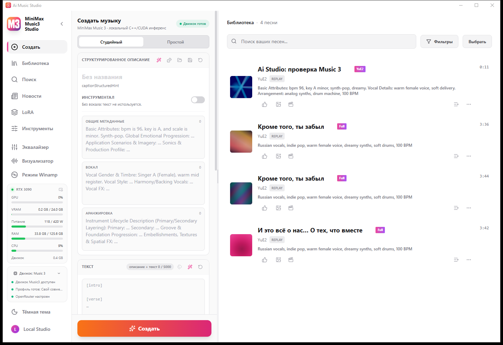

<div align="center">


# Ai Music Studio

**One window, two engines.** YuE2 — songs with an editable score — and MiniMax Music 3 — full-length tracks — switchable while the studio is running.

[Download the installer](https://github.com/Astemiir/Ai-Music-Studio/releases/latest) · [Русская версия](README.ru.md)

</div>

This is an **unofficial hybrid**, built by merging the two studios by
[timoncool](https://github.com/timoncool) — [YuE2 Studio](https://github.com/timoncool/YuE2-Studio) and
[MiniMax Music3 Studio](https://github.com/timoncool/MiniMax-Music3-Studio) — which share one shell and differ in
their engine. The native engines are [ServeurpersoCom](https://github.com/ServeurpersoCom)'s `yue2.cpp` and
`minimaxmusic.cpp`, both on ggml. Not affiliated with either author; all credit for the studios and engines is theirs.

| Music 3 | YuE2 |
|---|---|
|  |  |

## What one window over two engines means

- **The Engine button** at the bottom of the left panel switches between **YuE2** and **Music 3**. The service process
  under the open window is swapped — no restart, just a brief page reload.
- **Each engine brings a preset**, not a patch: the creation form (style tags, score, cover for YuE2; a structured
  caption for Music 3), the interface strings, the mark in the sidebar and the window/taskbar icon, the news page and
  the changelog, the model roles in *Settings → Models*, and the engine badge on every track in the library.
- **The choice is remembered.** The studio opens on the engine it was closed on.
- **One library, one model folder, one settings folder** serve both engines.

## Requirements

| | |
|---|---|
| System | Windows 10/11 x64 |
| GPU | NVIDIA with a driver **580 or newer** (the installer ships the CUDA 13 backend). Vulkan and CPU backends work too, considerably slower |
| Disk | ~620 MB for the program, plus **4–34 GB** for the model sets, which the studio downloads on first run |
| Rights | none — the installer needs no administrator |

## Install

1. Download **`Ai-Music-Studio-3.0.0-setup-windows-x64.exe`** from [Releases](../../releases) and run it.
2. On the first start the studio offers to download a verified model set for the engine it is on; switch engines and it
   offers the other engine's set. Nothing else is downloaded without asking.
3. Models are **not** part of the installer: YuE2 weights alone are 4–34 GB depending on the quantisation.

## Before you publish anything you make

- **YuE2 weights are CC BY-NC 4.0 — non-commercial use only.** Music generated with the YuE2 engine cannot be sold.
  The licence of the Music 3 weights is stated in the MiniMax Music3 Studio repository.
- The studios and the engines are MIT; the VST3 host bundled with them carries its own licences (see
  `resources/vst-host`).

## Notes

- The authors' auto-updater is **switched off** in this build: a release of theirs would replace the two-engine studio
  with a one-engine one.
- Engine logs (`data/engine.log`, `data/engine-startup.log`) are emptied once per start, so they describe the current
  session only.
- Updates from the upstream studios are merged into the `hybrid` branch by hand.

## Build from source

```bash
# frontend + shell (Tauri 2)
cd app && npm ci && cd ..
cd desktop && node_modules/.bin/tauri build --no-bundle      # → src-tauri/target/release/Ai-Music-Studio.exe

# the YuE2 service, shipped beside the shell as yue2-service.exe
cargo build --release -p music-server                        # → target/release/music-server.exe

# the Music 3 service (mm3-service.exe) is built from the MiniMax Music3 Studio repository
```

`app/data/changelog.json` is generated from the repository history: run `node scripts/changelog.mjs` after cloning,
or the frontend build stops on the missing import.

## Credits

| Part | Author | Licence |
|---|---|---|
| YuE2 Studio, MiniMax Music3 Studio (shell, service, UI) | [timoncool](https://github.com/timoncool) | MIT |
| `yue2.cpp`, `minimaxmusic.cpp` (native engines) | [ServeurpersoCom](https://github.com/ServeurpersoCom) | MIT |
| HOT-Step VST3 host (`resources/vst-host`) | HOT-Step | see `LICENSE-HOT-Step.txt` |
| The hybrid, engine switcher and per-engine presets | [Astemiir](https://github.com/Astemiir) | MIT |
