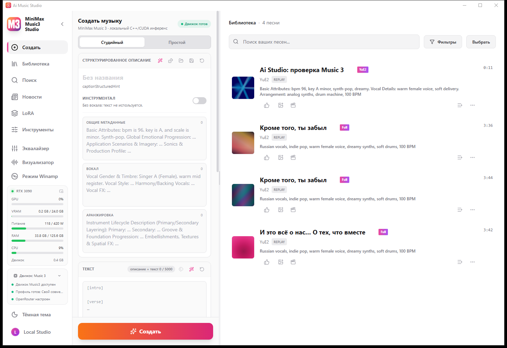

<div align="center">


# Ai Music Studio

**Одно окно — два движка.** YuE2 — песни с редактируемой партитурой — и MiniMax Music 3 — полноформатные треки —
переключаются прямо во время работы студии.

[Скачать установщик](https://github.com/Astemiir/Ai-Music-Studio/releases/latest) · [English version](README.md)

</div>

Это **неофициальный гибрид**: две студии [timoncool](https://github.com/timoncool) —
[YuE2 Studio](https://github.com/timoncool/YuE2-Studio) и
[MiniMax Music3 Studio](https://github.com/timoncool/MiniMax-Music3-Studio) — сведены в одну оболочку, потому что
каркас у них общий, а различает их движок. Нативные движки — `yue2.cpp` и `minimaxmusic.cpp` от
[ServeurpersoCom](https://github.com/ServeurpersoCom), оба на ggml. Проект не связан с авторами; все заслуги по
студиям и движкам — их.

| Music 3 | YuE2 |
|---|---|
|  |  |

## Что значит «одно окно на два движка»

- **Кнопка «Движок»** внизу левой панели переключает **YuE2** и **Music 3**. Меняется служебный процесс под уже
  открытым окном — без перезапуска, только короткая перезагрузка страницы.
- **У каждого движка свой пресет**, а не заплатка: форма создания (стиль, партитура, кавер у YuE2; структурированное
  описание у Music 3), тексты интерфейса, надпись и иконка в шапке, иконка окна и панели задач, новости и история
  версий, роли моделей в *Настройки → Модели* и бейдж движка у каждой песни в библиотеке.
- **Выбор запоминается:** студия открывается на том движке, на котором её закрыли.
- **Библиотека, модели, адаптеры и настройки — общие** для обоих движков: одна папка.

## Требования

| | |
|---|---|
| Система | Windows 10/11 x64 |
| Видеокарта | NVIDIA с драйвером **580 или новее** (в установщике сборка под CUDA 13). Vulkan и CPU тоже работают, но заметно медленнее |
| Диск | ~620 МБ на программу плюс **4–34 ГБ** на наборы моделей, которые студия скачивает при первом запуске |
| Права | не нужны: установщик ставится без администратора |

## Установка

1. Скачать **`Ai-Music-Studio-3.0.0-setup-windows-x64.exe`** из [релизов](../../releases) и запустить.
2. При первом запуске студия предложит скачать проверенный набор моделей для текущего движка; переключите движок —
   предложит набор второго. Больше ничего без спроса не качается.
3. Моделей в установщике нет: только веса YuE2 — это 4–34 ГБ в зависимости от кванта.

## Прежде чем публиковать созданное

- **Веса YuE2 — CC BY-NC 4.0, только некоммерческое использование.** Музыку, сделанную на движке YuE2, продавать
  нельзя. Лицензия весов Music 3 указана в репозитории MiniMax Music3 Studio.
- Студии и движки — MIT; VST3-хост в комплекте идёт со своими лицензиями (см. `resources/vst-host`).

## Замечания

- Авторский автоапдейтер в этой сборке **выключен**: его релиз заменил бы двухдвижковую студию на однодвижковую.
- Логи движков (`data/engine.log`, `data/engine-startup.log`) очищаются один раз при запуске — в них только текущий
  сеанс.
- Обновления из апстримов авторских студий вливаются в ветку `hybrid` вручную.

## Сборка из исходников

```bash
# фронтенд и оболочка (Tauri 2)
cd app && npm ci && cd ..
cd desktop && node_modules/.bin/tauri build --no-bundle      # → src-tauri/target/release/Ai-Music-Studio.exe

# сервис YuE2, лежит рядом с оболочкой как yue2-service.exe
cargo build --release -p music-server                        # → target/release/music-server.exe

# сервис Music 3 (mm3-service.exe) собирается из репозитория MiniMax Music3 Studio
```

`app/data/changelog.json` генерируется из истории репозитория: после клонирования нужно выполнить
`node scripts/changelog.mjs`, иначе сборка фронтенда остановится на отсутствующем импорте.

## Благодарности

| Часть | Автор | Лицензия |
|---|---|---|
| YuE2 Studio, MiniMax Music3 Studio (оболочка, сервис, интерфейс) | [timoncool](https://github.com/timoncool) | MIT |
| `yue2.cpp`, `minimaxmusic.cpp` (нативные движки) | [ServeurpersoCom](https://github.com/ServeurpersoCom) | MIT |
| VST3-хост HOT-Step (`resources/vst-host`) | HOT-Step | см. `LICENSE-HOT-Step.txt` |
| Гибрид, переключатель движков и пресеты | [Astemiir](https://github.com/Astemiir) | MIT |
